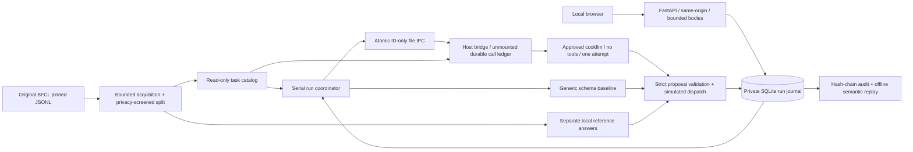

# TraceLab architecture

The app has no credentials, Docker socket, host shell, execution API, arbitrary remote URL fetch or real weather tool. It receives tasks/oracles as independent read-only mounts; only IPC is shared with the fixed host bridge. The bridge reconstructs public payloads by pinned identity and has no code path reading the oracle. Model output is untrusted and validated before every simulated dispatch. Containers run as a non-root host-matching UID with read-only root, dropped capabilities, no privilege escalation and512MiB cap. Docker uses normal bridge networking for functioning loopback publishing; this does not claim network egress isolation. Tool-free model execution and no arbitrary fetch/exec API are the application boundaries.

Store commits one immutable batch identity and each run before execution. The lifetime reservation cap12 and pending cap3 survive restarts. `awaiting` is committed before atomic request publication; a crash in that small gap consumes the reservation and fails closed. An intact pending file keeps its identity through restart. A completed response is consumed before testing for a missing request. Missing/changed/expired/orphan requests fail without inference recreation. Terminal files left across finish/cleanup crash are reconciled at startup. The host persists each attempted identity before invocation, rejects repeats and enforces its separate durable cap. A crash after inference but before response cannot be replayed automatically.

No DB and filesystem transaction is assumed atomic. The protocol accepts a visible interrupted run rather than risk duplicate model spending. Model connection failures retain valid measured attempt latency; local validation rejection has no model latency. Metadata arrays/deep JSON/nonfinite or oversized integers cannot kill the runner. A stopped runner makes health and new submissions503; app logs and persisted state guide explicit local restart.

Trace hashes chain actual timestamps and event payloads. Replay verifies that chain and task identity, reevaluates stored proposals with the same seed/fault, and compares timestamp-free semantic hash. The original run remains immutable and the replay has a parent link. This is accidental-tamper detection, not authenticated evidence against an editor who can rewrite the whole local journal. Declared fault retries are bounded local simulations; model calls never retry.

Versioning: task/catalog and oracle bytehashes + protocol identifier pin input/adapter semantics. Evaluation reports record source code hashes, environment and observed model metadata. The alias's changing provider backend is not visible, so perfect model-version reproduction is unavailable. Source snapshots and offline replay remain reproducible locally.
